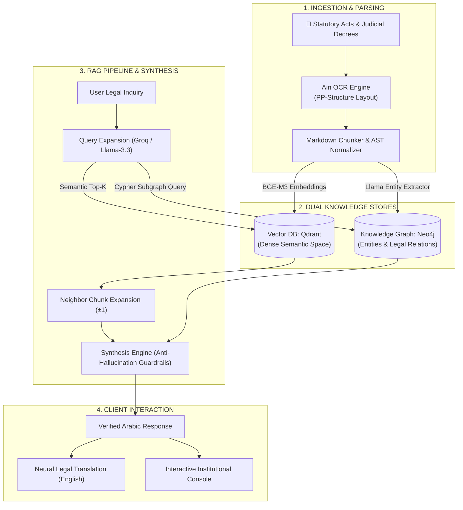

# Moroccan Legal GraphRAG ⚖️🧠

[](https://github.com/Rib4ko/Legal-GraphRag/actions/workflows/ci.yml)
[](https://www.python.org/)
[](https://fastapi.tiangolo.com)
[](https://react.dev/)
[](https://neo4j.com/)
[](https://qdrant.tech/)
[](LICENSE)

An advanced, hybrid AI retrieval engine for Moroccan jurisprudence and statutory texts. Combines high-dimensional semantic vector search (`BAAI/bge-m3`) with knowledge graph relationship discovery (`Neo4j`) and multilingual translation into an institutional-grade legal tech console.

---

## 🌟 Key Features

- **🔍 Dual-Channel Hybrid Retrieval:** Simultaneously queries vector space via Qdrant for semantic relevance and Neo4j knowledge graphs for multi-hop legal references.
- **🛡️ Strict Anti-Hallucination Framework:** Prompts enforce factual grounding strictly within retrieved statutory provisions.
- **🌐 Real-Time Arabic-to-English Translation:** Integrated neural translation pipeline for Moroccan Arabic legal texts with dedicated UI toggle.
- **⚡ Context Window Expansion:** Automatically pulls neighboring clauses (`chunk_index ± 1`) to preserve full legislative articles.
- **✨ Progressive AI Reveal Interface:** Institutional UI built with React 19, Tailwind CSS, and GSAP illustrating each step of graph expansion and answer synthesis.

---

## 📐 System Architecture



---

## 🚀 Quickstart & Setup

### 1. Prerequisites
- Python 3.11+
- Node.js 20+
- Running Qdrant and Neo4j instances

### 2. Backend Installation

```bash
# Clone the repository
git clone https://github.com/Rib4ko/Legal-GraphRag.git
cd Legal-GraphRag

# Create environment configuration
cat <<EOF > .env
HF_TOKEN=hf_your_huggingface_token
GROQ_API_KEY=gsk_your_groq_key
NEO4J_URI=neo4j+s://your-instance.databases.neo4j.io
NEO4J_USERNAME=neo4j
NEO4J_PASSWORD=your_password
EOF

# Install dependencies using uv or pip
pip install -e .

# Launch FastAPI ASGI server
uvicorn api:app --reload --port 8000
```

### 3. Frontend Installation

```bash
cd frontend
npm install
npm run dev
```

Navigate to `http://localhost:3000` to interact with the legal search console.

---

## 📄 License
This repository is open-source and released under the [MIT License](LICENSE).
